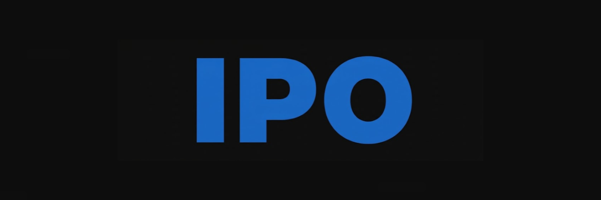
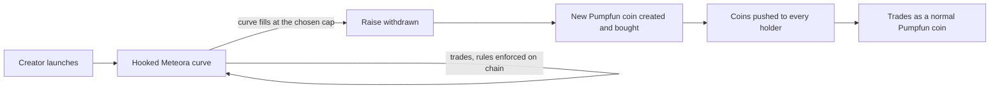

<p align="center"></p>

<h1 align="center">IPO: Initial Pump Offering</h1>

<p align="center">
Coins start on a rule-enforcing curve shaped like Pumpfun's, then migrate to Pumpfun with holders paid automatically.
</p>

<p align="center">
  <a href="https://ipopad.app">ipopad.app</a> ·
  <a href="https://x.com/LaunchOnIPO">@LaunchOnIPO</a> ·
  <a href="https://ipopad.app/how">How it works</a> ·
  <a href="https://ipopad.app/analytics">Analytics</a>
</p>

---

## What it does

A coin launched on IPO begins on a Meteora Dynamic Bonding Curve with a Token-2022 transfer hook, so its rules are checked on chain on every trade. The creator picks the market cap where it migrates. When the curve fills:

1. The hook is revoked, so the curve token has no more rules.
2. The raise is withdrawn and a new Pumpfun coin is created and bought in one transaction.
3. Every holder receives the Pumpfun coin in their wallet. There is nothing to claim and nothing to sign.



The coin changes address at migration. Holders usually receive about 97% to 99% of the amount they held, less on small curves with many holders. Meteora keeps 1% of the raise and Pumpfun charges its fee on the buy, and those costs come out of the raise. The platform's fee on that coin closes as much of the gap as it can.

## Rules on the curve

| | |
|---|---|
| **Anti-snipe tax** | 99% in the launch second, falling to the normal fee within 3 seconds. The creator's first buy inside the launch transaction skips it |
| **Max per wallet** | 3% of supply, on every coin, until migration |
| **Trade guard** | No single buy or transfer can move more than 3% of supply |
| **Anti-bundle** (optional) | One buy per block |
| **Trade only** (optional) | Wallet-to-wallet sends are refused |

Rules are written at launch and cannot be changed. They end at migration.

## Fees and rewards

Every curve trade pays **1.25%**, the same as Pumpfun: 0.30% creator, 0.70% platform, 0.25% Meteora. On a custom pair the fee is the creator fee (default, or 0.01% to 3%) plus 0.95%.

Creator rewards go to the creator or to the holders, chosen at launch:

- **Creator:** collect on the coin page any time while the coin is on its curve. Whatever is left is sent to the wallet at migration. The platform wallet claims these fees on chain and pays them out. An amount under 0.002 SOL is not sent.
- **Holders:** the creator's share on the curve buys holders more coins at migration, and Pumpfun's holder rewards apply after it.

Reusing a ticker within 24 hours of its free launch costs 1 SOL. After that it is free again.

## On chain

| | |
|---|---|
| Transfer hook program | [`D7JBFRvengCEwz6d3xNVZzFCwrFwvwWa4DbF4DkQjPmV`](https://solscan.io/account/D7JBFRvengCEwz6d3xNVZzFCwrFwvwWa4DbF4DkQjPmV) |
| Hook source | [`hk/hook/src`](hk/hook/src) |
| Deployed binary | [`hk/fixtures/ipo_hook.so`](hk/fixtures/ipo_hook.so), sha256 `1fae6ec1a41ba7340a50370fe3211adc1b61d736cae5eff18117419d45a6a0ed` |

The hook is upgradeable, and its upgrade authority is a separate cold wallet you can read on the explorer. To compare the binary, dump the program with `solana program dump` and hash the same number of bytes: the rest of the account is zero padding.

## Layout

```
api/          the site's server, launch and trade endpoints, and the migration service (api/graduator.mjs)
hk/hook/      the transfer hook program (Rust)
hk/lib/       curve configs, the migration pipeline (graduate.mjs), settlement, creator fees
lib/ ag/      Pumpfun instructions and IDLs
web/          the site (React, Vite)
scripts/      operator commands and the watchdog
tools/grind/  grinds addresses ending in `ipo`
test/ e2e/    unit tests, and tests on a local validator with mainnet programs cloned
```

More detail in [docs/ARCHITECTURE.md](docs/ARCHITECTURE.md).

## Run it locally

Needs Node 22.13 or newer. The server uses the built-in `node:sqlite`.

```bash
npm install
cp .env.example .env      # set SOLANA_RPC at least
npm run dev               # API and site with hot reload
```

```bash
npm test                  # unit tests
npm run build             # production build of the site
```

The validator tests load the mainnet programs and a hook with your own program id. You need the Solana CLI, your own keypair at `hk/keys/hook-keypair.json`, and a hook built for that id:

```bash
CLONE_RPC_URL=<rpc> bash e2e/validator-window.sh    # local validator on :8981
node e2e/window.mjs                                 # the hook and the whole migration
FILL=1 node e2e/api-window.mjs                      # the site's API, launch to migration
node e2e/api-rules.mjs                              # creator rules
TEST_SIZES=3 node e2e/api-creator-fee.mjs           # creator fee collection and payout
node e2e/api-official.mjs                           # the official launch
```

## Security

Found a problem? See [SECURITY.md](SECURITY.md). Please report it privately before posting it.

Coins launched here are created by their launchers, not by IPO. Trading them is risky and you can lose what you put in. Nothing here is financial advice.

## License

No license has been granted yet, so all rights are reserved. The code is public so you can read and verify it.
